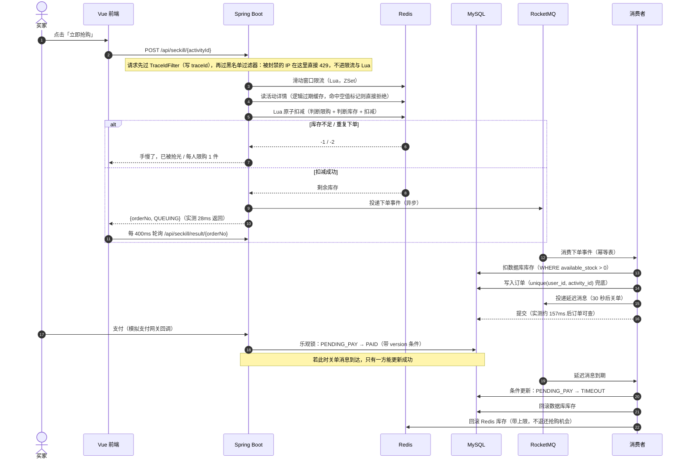

<div align="center">
  <h2>FlashMart</h2>

  <p>
    
    
    
    
    
    
    
    
    <a href="./LICENSE"></a>
  </p>
</div>

<div align="center">

面向买家与商家的<strong>限时抢购电商平台</strong>。

覆盖 <strong>活动发布 → 热点数据缓存 → 高并发抢购 → 异步下单削峰 → 支付 → 超时关单</strong> 的完整业务闭环。

</div>

---

## 项目背景

限时抢购把「缓存、限流、消息队列、并发一致性」四个问题压缩到了同一条主链路上，每个问题都能用数字验收：

| 业务矛盾 | 典型现象 | 本项目的解法 |
| --- | --- | --- |
| **瞬时并发打满数据库** | 开抢瞬间几千个请求同时写订单，数据库连接池瞬间打满、响应雪崩 | Redis + Lua 原子扣减 + RocketMQ 异步下单削峰 |
| **超卖与重复下单** | 库存 100 件卖出 103 件；同一用户刷出多单 | Lua 里"判断限购 + 判断库存 + 扣减"一次原子执行，数据库唯一索引兜底 |
| **热点缓存被击穿/穿透** | 热门活动缓存一过期，全量请求打到数据库；查不存在的 id 反复穿透 | 逻辑过期 + 异步重建 + SETNX 互斥；空值缓存 + 短 TTL |
| **缓存与数据库不一致** | 商家改了库存，用户看到的还是旧数据 | Cache Aside + MQ 补偿重试 + 延迟双删 + TTL 兜底 |
| **订单状态被并发改乱** | 支付回调与超时关单同时到达，订单被关掉却又扣了款 | 乐观锁 + 状态前置条件更新（只允许从待支付出发） |

## 核心功能

### ⚡ 抢购主链路：Lua 原子扣减 + 消息队列削峰

> 用户只等一次 Redis 原子操作的时间；写数据库的活全部交给消费者。

- **Redis + Lua 原子扣减** — 把「判断限购 + 判断库存 + 扣减库存」合成一次原子执行：分成三条命令的话，并发下会出现两个请求都读到库存 1 而双双扣减（超卖），或者同一用户的两个请求都判定"没买过"（重复下单）。
- **一人一单** — 已购记录用 Hash 存（`userId -> 已购数量`），支持"每人限购 N 件"；数据库侧再用 `unique(user_id, activity_id)` 兜底，Redis 判断失效也落不下第二单。
- **削峰** — 抢购接口只做四件事：校验活动（走缓存）、Lua 扣减、生成订单号、投递 MQ 后立刻返回；订单落库、扣数据库库存、发延迟关单消息全在消费者侧完成。实测 50 并发下异步版 **176 req/s（P99 329 ms）**，同步对照组 **39 req/s（P99 1462 ms）**。

### 🧱 缓存架构：击穿、穿透、一致性

> 缓存不是"加一层 Redis"，而是三种失效场景各有各的解法。

- **逻辑过期防击穿** — 缓存里额外存一个逻辑过期时间（物理 TTL 给 3 倍），逻辑过期后**不删 key**，而是返回旧值 + 后台异步重建（SETNX 互斥）。这样重建期间请求既不阻塞、也不会打穿数据库；缓存被完全删掉时还有一条带互斥的冷启动路径。实测缓存被删后 **100 并发只回源数据库 1 次**。
- **空值缓存防穿透** — 查不到的数据也写一份空值标记（30 秒 TTL），同一批不存在的 id 只打一次数据库。实测查不存在的活动 **200 次只回源 1 次**。
- **Cache Aside + 补偿 + 延迟双删** — 更新数据库后删缓存（而不是更新缓存，避免并发写导致旧值覆盖）；删除失败落补偿任务并投 MQ 重试；再投一条延迟 5 秒的消息做延迟双删，清掉并发读可能回填的旧值；最后还有 TTL 兜底。

### 🛡️ 滑动窗口限流

> 令牌桶允许突发，滑动窗口精确限次——抢购接口要的是后者。

- **ZSet + Lua + AOP 注解** — ZSet 存请求时间戳，Lua 一次完成"清理过期成员 + 统计 + 写入"，不原子的话并发下会集体超发；注解支持**全局 / IP / 用户**三个维度，身份一律取自服务端上下文。
- **实测**：同一用户 1 秒内 10 并发抢购 → 通过 5 次 + 5 次 429；改成每 1.2 秒 1 次匀速请求 → 全部通过（只拦突发、不拦匀速）。
- **限流之上再加一层 IP 黑名单** — 同一个客户端 IP 在 60 秒内被限流拒绝 20 次就封禁 300 秒；封禁期内请求在**黑名单过滤器层**就被 429 返回、不再跑限流 Lua（取客户端 IP 的规则收敛在 `ClientIpResolver` 一处，拦截器 / 切面 / 过滤器共用）。**边界**：`X-Forwarded-For` 可伪造，"换一个伪造 IP"就能绕开；阈值 / 窗口 / 封禁时长是策略值、没按真实流量调过参；惩罚落在 IP 上，同一 NAT 出口下的其它账号会被一起挡住（账号级封禁没做）。

### ⏱️ 延迟消息超时关单

> 不用定时任务扫全表，让消息自己在 30 秒后回来。

- **RocketMQ 延迟消息**（固定档位 1s/5s/10s/30s/1m…，按业务秒数取最接近且不小于它的档位）：下单成功后投一条延迟消息，到点仍未支付就关单并回滚库存。
- **关单与库存回滚** — 关单只允许从"待支付"出发；成功后才回滚**数据库与 Redis 两侧**库存。设计上**只回滚库存、不退还该用户的抢购机会**：名额已经用掉，不付款就作废，库存退回池子给其他人抢——这正是真实秒杀的规则。实测关单后两侧库存各 +1，该用户再抢会被"一人一单"拦下。

### 🔒 乐观锁保证状态流转

> 支付回调和超时关单可能同一毫秒到达，只能有一个成功。

- **条件更新 + 版本号** — `UPDATE ... SET status='PAID', version=version+1 WHERE order_no=? AND status='PENDING_PAY' AND version=?`，返回 0 行说明状态已被别人改过；关单走同样的条件更新，所以**已支付的订单不可能被关掉、也不可能被误回滚库存**。
- **支付幂等** — 重复支付返回"订单已支付，无需重复支付"，不会重复扣款。

### 🧩 工程与可观测

- **traceId 全链路** — HTTP 入口生成（或沿用调用方的 `X-Trace-Id`），随消息属性传到消费者，一次抢购跨接口 / MQ / 消费端的日志能用同一个 ID 串起来。
- **消费幂等表** — `mq_consume_log` 用 `msg_id` 唯一索引判断首次消费，区分处理中/成功/失败。
- **配置全外置** — 数据库、Redis、RocketMQ、JWT 密钥全部支持环境变量覆盖，本地有默认值、上线改环境变量即可。
- **压测工具** — 仓库自带一个纯 JDK 的压测/实验工具（`bench/Bench.java`，无第三方依赖），10 个实验覆盖超卖、一人一单、削峰、击穿、穿透、限流、超时关单、支付幂等、应用层 IP 黑名单。

## 系统流程



## 技术选型与取舍

| 选型 | 选择了 | 没有选择 | 原因 |
| --- | --- | --- | --- |
| 库存扣减 | Redis + Lua 原子脚本 | Redisson 分布式锁 | 扣减是"读-判断-写"三步，Lua 在 Redis 内一次原子完成，比加锁少一次往返；数据库再用唯一索引与条件更新兜底 |
| 下单写库 | RocketMQ 异步 | 请求线程同步写 | 开抢瞬间的并发是"尖峰"，同步写会打满连接池；异步把尖峰摊平成队列 |
| 防缓存击穿 | 逻辑过期 + 异步重建 | 纯互斥锁重建 | 互斥锁会让请求排队等待，逻辑过期则返回旧值继续服务，重建在后台做 |
| 限流算法 | 滑动窗口（ZSet + Lua） | 令牌桶 / 固定窗口 | 抢购要"精确限次、不预支突发额度"；固定窗口还有边界双倍流量的漏洞 |
| 状态流转 | 乐观锁 + 状态前置条件 | 悲观锁 / 分布式锁 | 冲突概率低、临界区只改一行，乐观锁成本更低；条件更新本身就能表达"只允许从待支付出发" |
| 关闭超时订单 | RocketMQ 延迟消息 | 定时任务扫表 | 扫表要处理"扫哪些、扫多少、漏扫"；延迟消息到期自己回来，且服务重启不丢 |
| 缓存一致性 | Cache Aside + 补偿 + 双删 + TTL | 先删缓存 / 更新缓存 | 先删缓存有并发漏洞；更新缓存会有旧值覆盖新值且不自愈；删除幂等且天然自愈 |
| 消息中间件 | RocketMQ | Kafka | 需要原生延迟消息与死信队列，量级也用不上 Kafka 的吞吐 |
| 技术栈收敛 | 不加 MinIO / LangChain4j / Redisson | —— | 本项目不需要对象存储（商品图用色块）、不需要大模型、加锁需求由 Lua + 乐观锁 + 唯一索引覆盖 |

## 快速开始

### 1. 启动中间件

```bash
docker compose up -d          # MySQL 13307 / Redis 6380 / RocketMQ 9877 / Dashboard 8181
```

首次启动会自动执行 `server/src/main/resources/db/` 下的建表与演示数据脚本。

### 2. 启动后端

```bash
cd server && mvn spring-boot:run
```

接口文档：<http://localhost:18090/doc.html>

### 3. 启动前端

```bash
cd web && npm install && npm run dev
```

打开 <http://localhost:5274>。前端通过 Vite 代理把 `/api` 转发到 `http://localhost:18090`，代码里不写死后端地址。

### 演示账号（密码都是 123456）

| 角色 | 手机号 | 能做什么 |
| --- | --- | --- |
| 买家 | 13911110001 | 浏览抢购活动、抢购、支付、查看我的订单 |
| 买家 | 13911110002 | 同上（用来演示"不同用户抢同一件商品"） |
| 商家 | 13811110001 | 创建商品、创建/修改抢购活动、查看活动订单 |
| 商家 | 13811110002 | 同上 |

## 实测数据

所有数字都是在本机真实压测出来的（Windows + Docker 中间件，压测客户端与服务同机，闭环压测模型，测前清空数据表并等 MQ 队列排空）。
完整命令与输出见 **[bench/README.md](bench/README.md)**。

| 指标 | 结果 |
| --- | --- |
| 抢购接口返回耗时 | **28 ms**（只做校验与投递消息，不等数据库） |
| 异步下单落库 | 接口返回后约 **157 ms** 订单可查（状态待支付） |
| **削峰对比（50 并发 / 2000 请求）** | 异步版 **176 req/s**、平均 280.66 ms、P99 **329 ms**；同步对照组 **39 req/s**、平均 1259.62 ms、P99 **1462 ms** → **吞吐约 4.5 倍，P99 降 77%** |
| **超卖验证（30 件库存 / 60 个用户并发）** | 成功 30 次、落库 30 单、**数据库与 Redis 剩余库存都是 0**——成功数 = 落库数 = 总库存，无超卖、库存非负 |
| 一人一单（同一用户并发 20 次） | 成功 1 次 + 限购 4 次 + 429 共 15 次（限流在限购之前）；改成每 1.2 秒 1 次匀速请求 → 全部被"一人一单"拦下 |
| 滑动窗口限流 | 1 秒内 10 并发 → **5 通过 + 5 × 429**；匀速请求全部通过 |
| 缓存击穿（缓存被删后 100 并发） | **回源数据库 1 次**，100 个请求总耗时 114 ms |
| 缓存击穿（逻辑过期瞬间 100 并发） | 全部成功，**只触发 1 次异步重建**，耗时 119 ms |
| 缓存穿透（查不存在的活动 200 次） | **回源 1 次** |
| 超时关单 | 生产档位（30 秒）实测：抢购后不支付，**第 30 秒订单状态变为 TIMEOUT**，数据库与 Redis 库存**各回滚 1 件**。压测工具里的 timeout 实验走的是"1 秒档强制关单"接口（便于快速验证），那组观察值是 22 ms |
| 支付幂等 | 两次支付都返回已支付，第二次提示"订单已支付，无需重复支付" |
| 登录 IP 维度限流 | 并发 30 次登录 → 通过 20 + 限流 10（阈值 20 次/秒） |
| 应用层 IP 黑名单（被封的 IP 不再跑限流 Lua） | 阈值调小到 5 次 / 60 秒、封禁 60 秒：伪造 `X-Forwarded-For` 的 IP 在 1 秒内 10 并发 → **200 × 5（1 成功 + 4 限购）+ 429 × 5**，突发耗时 **0.102 s**，违规累计到阈值后该 IP `banned=true`；封禁后同 IP 再打 10 次 → **10/10 全是黑名单 429**，而 `limiterCalls` 增量为 0、`blacklistRejected` 增量为 10（命中黑名单时一次限流 Lua 都没跑）；换对照 IP 打 3 次 → 黑名单拒绝 0 次、`banned=false`（按 IP 隔离） |

## 目录结构

    flashmart/
    ├─ docker-compose.yml            # 一键起 MySQL / Redis / RocketMQ / Dashboard
    ├─ deploy/                       # RocketMQ broker 配置、MySQL 客户端字符集配置
    ├─ docs/                         # 项目方案、实施与验收、代码地图
    ├─ bench/                        # 纯 JDK 压测工具 + 实验说明与实测结果
    ├─ web/                          # Vue 3 前端（登录、抢购专区、活动详情、我的订单、商家后台）
    └─ server/
       ├─ pom.xml
       └─ src/main/
          ├─ java/com/flashmart/
          │  ├─ common/
          │  │  ├─ auth/       JwtUtil、AuthInterceptor（JWT + Redis 会话）
          │  │  ├─ blacklist/  ClientIpResolver（全项目唯一取 IP 实现）、BlacklistService（封禁 + 违规计数）、BlacklistFilter（过滤器层直接 429）
          │  │  ├─ cache/      RedisCacheClient（逻辑过期 / 空值缓存 / 回源计数）
          │  │  ├─ limiter/    @SlidingWindowLimit 注解 + 切面 + ZSet/Lua 限流器
          │  │  ├─ mq/         Topic、事件、生产者（含延迟档位换算与发送兜底）、消费幂等
          │  │  ├─ context/    UserContext（当前用户，限流与归属校验都靠它）
          │  │  ├─ trace/      traceId 过滤器
          │  │  ├─ exception/  业务异常与全局异常处理（429/403/404 统一返回）
          │  │  └─ result/     R 统一响应
          │  ├─ config/        WebConfig、MybatisPlusConfig（乐观锁插件）
          │  └─ modules/
          │     ├─ auth/       注册登录、BCrypt、JWT 签发
          │     ├─ product/    商品
          │     ├─ activity/   抢购活动（缓存读写、商家维护、缓存失效）
          │     ├─ seckill/    抢购主链路（Lua 扣减、订单号生成）
          │     ├─ order/      订单（乐观锁支付、超时关单、库存回滚）
          │     ├─ merchant/   商家后台接口
          │     ├─ cache/      缓存删除补偿任务
          │     ├─ mq/         三个消费者（下单、超时关单、缓存补偿）
          │     └─ bench/      压测专用接口（bench profile 才注册）
          └─ resources/
             ├─ application.yml        全量配置（全部支持环境变量覆盖）
             ├─ lua/seckill_stock.lua  抢购扣减：判断限购 + 判断库存 + 扣减，一次原子执行
             ├─ lua/rollback_stock.lua 回滚库存（带总库存上限）
             ├─ lua/sliding_window.lua 滑动窗口限流
             └─ db/schema.sql, data.sql

## 已知边界

写在这里是因为这些都是我在实现过程中就知道、并且明确没有做的事：

- **支付是模拟的支付网关回调**：真实项目里支付要对接三方网关、处理异步回调验签与对账，这里只保留了"回调触发状态流转"这一步。
- **没有本地消息表**：异步发送失败会同步重发一次兜底，但极端情况（发消息前进程崩溃）理论上仍会丢一条消息；正确做法是先落库再发消息，或用本地消息表。
- **Redis 与 RocketMQ 都是单节点**：没有集群、哨兵与多副本，生产环境需要换成集群方案。
- **缓存不一致没有做量化验证**：延迟双删是概率手段，只能缩小不一致窗口，无法证明"绝对一致"；本项目也没做对账任务。
- **订单号在单进程内保证不重复**：多实例部署时各实例的序列独立，理论上存在同一秒撞号的可能，届时应换成全局序列（Redis INCR）或雪花算法（数据库 `order_no` 唯一索引是最后一道兜底）。
- **压测环境是本机 Docker**：数字只能说明趋势，不代表线上表现。
- **没有接入监控告警**：目前用 traceId 串日志 + 消费记录表/补偿任务表排查，未接入 Prometheus 等指标系统。
- **不做推荐算法与分布式事务**：商品图用色块代替对象存储；项目聚焦在"缓存、限流、并发扣减、消息队列"这四件事上。
- **外层（网关）限流与自动黑名单没有做**：入口没有网关这一层，每次被拒的请求仍要走一次应用层判断；只有真正进了黑名单的 IP 才是"连限流 Lua 都不跑"。
- **`X-Forwarded-For` 可以伪造**：解析客户端 IP 时优先读 XFF 第一段，攻击者每次换一个伪造 IP 就能绕开按 IP 的黑名单与 IP 维度限流；根治要在最外层网关剥离外部 XFF 并写入可信头（部署层改动，本项目刻意未做）。
- **黑名单阈值是策略值**：20 次违规 / 60 秒窗口 / 封禁 300 秒是演示默认值，没有真实流量调参依据；调小会误伤共享 IP（NAT / 校园网），调大等于没封，生产要按真实流量分布调。
- **账号级封禁没有做**：惩罚落在 IP 上，USER 维度被限流时同一 NAT 出口下的其它账号会被一起挡住；账号维度的处置由 Redis 会话失效承担（删 `session:token:{userId}` 即失效）。

## 文档

| 文档 | 内容 |
| --- | --- |
| [docs/01-项目方案-FlashMart.md](docs/01-项目方案-FlashMart.md) | 完整方案：业务闭环、架构、七个技术点的痛点与实现、数据模型、关键流程、接口清单、设计决策记录 |
| [docs/02-实施计划与验收.md](docs/02-实施计划与验收.md) | 分阶段实施计划与验收清单（含端到端验收步骤与常见坑） |
| [docs/03-代码地图与已实现清单.md](docs/03-代码地图与已实现清单.md) | 代码地图、实现状态、本地运行与验证、Redis key 与 MQ 主题速查 |
| [bench/README.md](bench/README.md) | 压测与实验工具：怎么跑、每个实验在验证什么、实测结果与踩坑记录 |

## License

[MIT](LICENSE)
